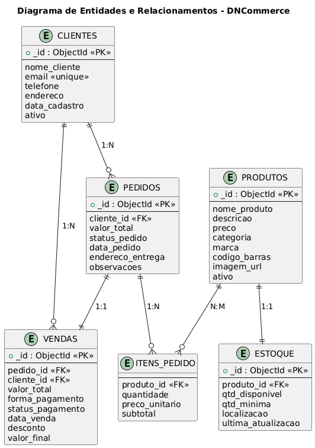
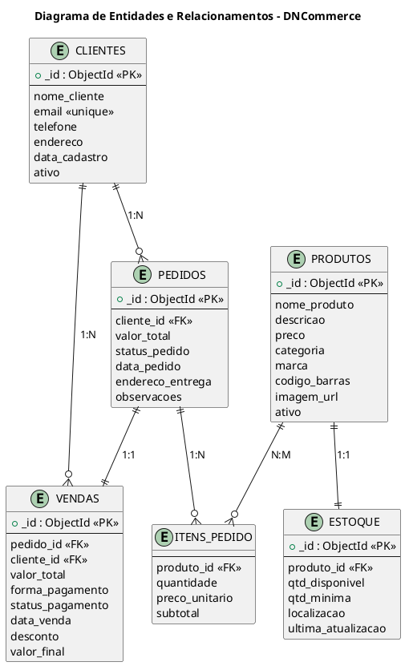

# DNCommerce API

Sistema de gerenciamento de estoque e pedidos desenvolvido para o desafio de Integração e Modelagem de Dados da DNC.

## Sobre

API REST para uma loja de produtos de beleza. Permite gerenciar clientes, produtos, estoque, pedidos e vendas. Desenvolvida com Node.js, Express e MongoDB.

## Tecnologias

- Node.js
- Express
- MongoDB
- Mongoose
- CORS
- Dotenv

## Modelagem do Banco de Dados



```
┌──────────────────┐                              ┌──────────────────┐
│     CLIENTES     │                              │     PRODUTOS     │
├──────────────────┤                              ├──────────────────┤
│ _id (PK)         │                              │ _id (PK)         │
│ nome_cliente     │                              │ nome_produto     │
│ email (unique)   │                              │ descricao        │
│ telefone         │                              │ preco            │
│ endereco         │                              │ categoria        │
│ data_cadastro    │                              │ marca            │
│ ativo            │                              │ codigo_barras    │
└────────┬─────────┘                              │ imagem_url       │
         │                                        │ ativo            │
         │ 1:N                                    └────────┬─────────┘
         │                                                 │
         ▼                                                 │ 1:1
┌──────────────────┐                              ┌────────▼─────────┐
│     PEDIDOS      │                              │     ESTOQUE      │
├──────────────────┤                              ├──────────────────┤
│ _id (PK)         │                              │ _id (PK)         │
│ cliente_id (FK)  │                              │ produto_id (FK)  │
│ valor_total      │                              │ qtd_disponivel   │
│ status_pedido    │                              │ qtd_minima       │
│ data_pedido      │                              │ localizacao      │
│ endereco_entrega │                              │ ultima_atualizao │
│ observacoes      │                              └──────────────────┘
└───┬─────────┬────┘
    │         │
    │ 1:1     │ 1:N
    │         │
    ▼         ▼
┌──────────────────┐     ┌──────────────────┐
│     VENDAS       │     │   ITENS_PEDIDO   │
├──────────────────┤     ├──────────────────┤
│ _id (PK)         │     │ produto_id (FK)  │◄─── N:M ───┐
│ pedido_id (FK)   │     │ quantidade       │            │
│ cliente_id (FK)  │     │ preco_unitario   │      PRODUTOS
│ valor_total      │     │ subtotal         │
│ forma_pagamento  │     └──────────────────┘
│ status_pagamento │
│ data_venda       │
│ desconto         │
│ valor_final      │
└──────────────────┘
```

<details>
<summary>Código PlantUML</summary>



</details>

## Como usar

Clone o repositório e instale as dependências:

```bash
git clone https://github.com/lucas-gonzales-dev/dncommerce-api.git
cd dncommerce-api
npm install
```

Configure o arquivo `.env`:

```env
PORT=3000
MONGODB_URI=mongodb://localhost:27017/dncommerce
```

Inicie o servidor:

```bash
npm start
```

Acesse `http://localhost:3000` para verificar se a API está rodando.

## Estrutura

```
├── src/
│   ├── config/
│   │   └── database.js
│   ├── controllers/
│   │   ├── clienteController.js
│   │   ├── produtoController.js
│   │   ├── estoqueController.js
│   │   ├── pedidoController.js
│   │   └── vendaController.js
│   ├── models/
│   │   ├── Cliente.js
│   │   ├── Produto.js
│   │   ├── Estoque.js
│   │   ├── Pedido.js
│   │   └── Venda.js
│   ├── routes/
│   │   ├── clienteRoutes.js
│   │   ├── produtoRoutes.js
│   │   ├── estoqueRoutes.js
│   │   ├── pedidoRoutes.js
│   │   └── vendaRoutes.js
│   └── server.js
├── docs/
│   └── diagrama-er.png
├── .env
├── .gitignore
├── package.json
└── README.md
```

## API Endpoints

### Clientes

| Método | Rota | Descrição |
|--------|------|-----------|
| GET | /clientes | Lista todos os clientes |
| GET | /clientes/:id | Busca cliente por ID |
| POST | /clientes | Cadastra novo cliente |
| PUT | /clientes/:id | Atualiza cliente |
| DELETE | /clientes/:id | Remove cliente |

### Produtos

| Método | Rota | Descrição |
|--------|------|-----------|
| GET | /produtos | Lista todos os produtos |
| GET | /produtos/:id | Busca produto por ID |
| POST | /produtos | Cadastra novo produto |
| PUT | /produtos/:id | Atualiza produto |
| DELETE | /produtos/:id | Remove produto |

### Estoque

| Método | Rota | Descrição |
|--------|------|-----------|
| GET | /estoque | Lista todo estoque |
| GET | /estoque/alertas/baixo | Lista produtos com estoque baixo |
| GET | /estoque/:produtoId | Busca estoque de um produto |
| PUT | /estoque/:produtoId | Atualiza estoque |
| POST | /estoque/:produtoId/adicionar | Adiciona quantidade ao estoque |

### Pedidos

| Método | Rota | Descrição |
|--------|------|-----------|
| GET | /pedidos | Lista todos os pedidos |
| GET | /pedidos/:id | Busca pedido por ID |
| POST | /pedidos | Cria novo pedido |
| PUT | /pedidos/:id/status | Atualiza status do pedido |
| DELETE | /pedidos/:id | Remove pedido |

### Vendas

| Método | Rota | Descrição |
|--------|------|-----------|
| GET | /vendas | Lista todas as vendas |
| GET | /vendas/relatorio | Relatório de vendas |
| GET | /vendas/:id | Busca venda por ID |
| POST | /vendas | Registra nova venda |
| PUT | /vendas/:id/pagamento | Atualiza status do pagamento |

## Funcionalidades

- Cadastro e gerenciamento de clientes
- Cadastro de produtos com categorias (maquiagem, skincare, cabelos, etc.)
- Controle de estoque com alertas de quantidade mínima
- Criação de pedidos com múltiplos itens
- Registro de vendas com diferentes formas de pagamento
- Relatório de vendas por período

## Autor

Lucas Gonzales
