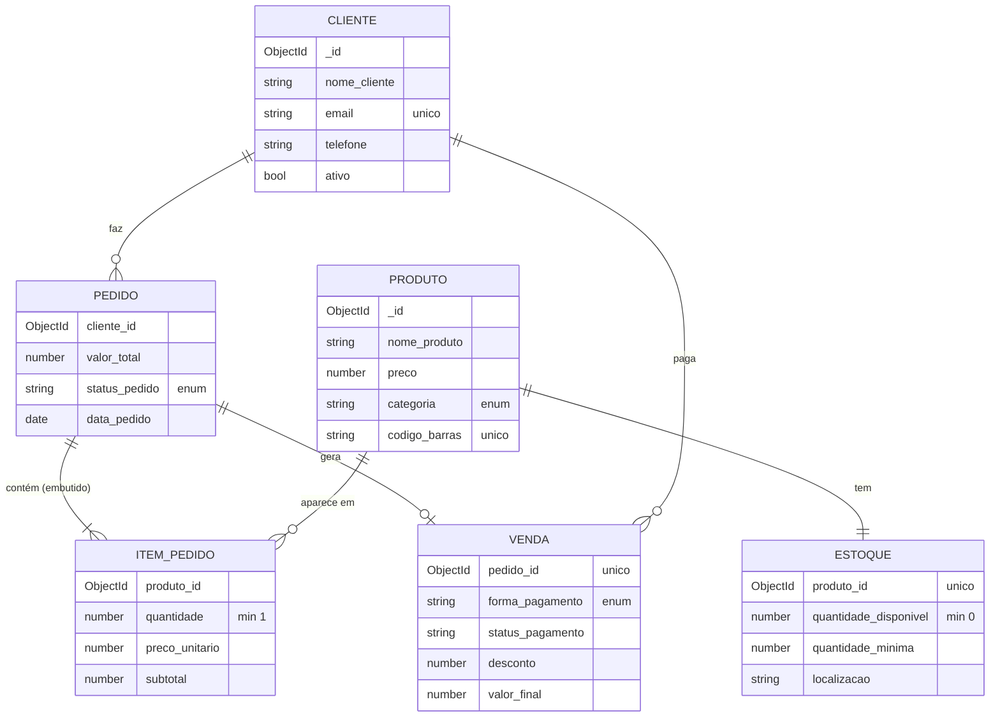

# DNCommerce API

   

API de uma loja de cosméticos: clientes, produtos, estoque, pedidos e vendas. O ponto central do projeto não são as rotas, é a **modelagem**: decidir o que é entidade, o que é relacionamento e o que fica embutido dentro do documento.

Desafio de *Integração e Modelagem de Dados* da formação **Engenheiro de Software (Escola DNC)**, entregue e aprovado na avaliação do projeto.

## Modelo de dados



## Decisões de modelagem

- **Itens do pedido embutidos no próprio pedido.** Um item não existe sem o pedido e é sempre lido junto com ele. Embutir evita uma coleção extra e um join a cada consulta.
- **Preço copiado para o item no momento da compra.** Se o preço do produto mudar amanhã, o pedido de hoje continua com o valor que o cliente pagou. Pedido é histórico, não referência viva.
- **Estoque separado do produto (1:1).** Produto é cadastro, que muda pouco. Estoque é operação, que muda o tempo todo. Separar deixa cada um com sua responsabilidade e permite o alerta de estoque mínimo.
- **Venda separada do pedido.** Pedido é a intenção de compra. Venda é o pagamento (forma, desconto, status). Um pedido cancelado não vira venda, e o `pedido_id` único impede duas vendas para o mesmo pedido.
- **Regras no schema.** Enums para status e forma de pagamento, `min: 0` em preço e estoque, e unicidade de e-mail e código de barras: o banco recusa dado inválido mesmo se alguém esquecer de validar na rota.

## O que a API faz além do CRUD

- Ao criar um pedido, **confere o estoque de cada item**, calcula subtotais e total, e baixa o estoque
- `GET /estoque/alertas/baixo` lista produtos no estoque mínimo ou abaixo dele
- `GET /vendas/relatorio` usa o **aggregation pipeline** do MongoDB (`$match` por período + `$group` por forma de pagamento) para devolver total vendido, ticket médio e o valor por forma de pagamento

## O que aprendi

- Modelagem em banco de documentos: quando embutir e quando referenciar
- Pensar no pedido como registro histórico (preço congelado, venda separada)
- Aggregation pipeline do MongoDB para relatório, em vez de somar tudo em JavaScript
- Organizar uma API Express em camadas: rotas, controllers e models

## Endpoints

### Clientes

| Método | Rota | Descrição |
|--------|------|-----------|
| GET | /clientes | Lista todos os clientes |
| GET | /clientes/:id | Busca cliente por ID |
| POST | /clientes | Cadastra novo cliente |
| PUT | /clientes/:id | Atualiza cliente |
| DELETE | /clientes/:id | Remove cliente |

### Produtos

| Método | Rota | Descrição |
|--------|------|-----------|
| GET | /produtos | Lista todos os produtos |
| GET | /produtos/:id | Busca produto por ID |
| POST | /produtos | Cadastra novo produto |
| PUT | /produtos/:id | Atualiza produto |
| DELETE | /produtos/:id | Remove produto |

### Estoque

| Método | Rota | Descrição |
|--------|------|-----------|
| GET | /estoque | Lista todo estoque |
| GET | /estoque/alertas/baixo | Lista produtos com estoque baixo |
| GET | /estoque/:produtoId | Busca estoque de um produto |
| PUT | /estoque/:produtoId | Atualiza estoque |
| POST | /estoque/:produtoId/adicionar | Adiciona quantidade ao estoque |

### Pedidos

| Método | Rota | Descrição |
|--------|------|-----------|
| GET | /pedidos | Lista todos os pedidos |
| GET | /pedidos/:id | Busca pedido por ID |
| POST | /pedidos | Cria novo pedido |
| PUT | /pedidos/:id/status | Atualiza status do pedido |
| DELETE | /pedidos/:id | Remove pedido |

### Vendas

| Método | Rota | Descrição |
|--------|------|-----------|
| GET | /vendas | Lista todas as vendas |
| GET | /vendas/relatorio | Relatório de vendas |
| GET | /vendas/:id | Busca venda por ID |
| POST | /vendas | Registra nova venda |
| PUT | /vendas/:id/pagamento | Atualiza status do pagamento |

## Rodando

```bash
git clone https://github.com/lucas-gonzales-dev/dncommerce-api.git
cd dncommerce-api
npm install
# .env
# PORT=3000
# MONGODB_URI=mongodb://localhost:27017/dncommerce
npm start
```

## O que eu faria diferente hoje

- **Criar o pedido e baixar o estoque dentro de uma transação.** Hoje a conferência e a baixa são passos separados: duas compras simultâneas do último item podem passar na conferência ao mesmo tempo. O caminho é uma transação do MongoDB, ou um `findOneAndUpdate` condicional (`quantidade_disponivel >= x`).
- Fazer a consulta de estoque baixo direto no banco (`$expr`) em vez de filtrar em memória
- Testes de integração com um MongoDB em memória
- Validação de payload com Zod na entrada das rotas

---

Feito por **Lucas Leite Gonzales** · [LinkedIn](https://www.linkedin.com/in/lucas-leite-gonzales-dev/)
